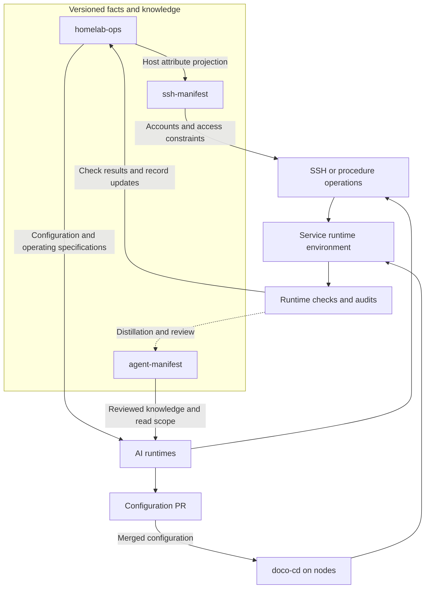

Following [Why run a homelab?](/en/posts/why-homelab/) and [Managing a homelab](/en/posts/managing-homelab-with-ai/), this article introduces the architecture and interfaces of this management system.

homelab-ops is an operations system organized around Git, AI runtimes, and mechanisms for execution on nodes. It gives environment declarations, access permissions, operation implementations, and lasting knowledge explicit structures, so different tools can work from the same context and leave results that can be traced.

The operations stack is a useful starting point for understanding the system. Its choices address specific kinds of work: storing and delivering configuration, observing runtime state, querying the history of individual tasks, and bringing problems to the attention of whoever needs to act.

| Work                                | Technology                           | Rationale and responsibility                                                                                                  |
| ----------------------------------- | ------------------------------------ | ----------------------------------------------------------------------------------------------------------------------------- |
| Configuration and collaboration     | Git, GitHub PRs / Issues, CI         | Organize changes through versions and diffs, link tasks, and run automated constraint checks                                  |
| Configuration delivery              | GitOps, Docker Compose, doco-cd      | Reuse existing Compose service definitions so nodes can retrieve accepted configuration and deploy it                         |
| Metrics collection                  | Grafana Alloy, standalone exporters  | Reuse standard metrics where possible; retain a mixed deployment according to node resources and collection capabilities      |
| Metrics storage and rules           | Prometheus                           | Store time series, support queries, and evaluate alerting rules                                                               |
| Trends and correlated views         | Grafana                              | Reuse existing dashboards; use queries, field joins, and transformations to inspect nodes and components                      |
| Task history and structured queries | SQLite, Datasette                    | Provide browsing, filtering, SQL, and APIs over existing event databases or read models, reusing a ready-made query interface |
| Alert processing                    | Alertmanager                         | Group, deduplicate, silence, inhibit, and route alerts generated by rules                                                     |
| Message delivery                    | ntfy and other notification channels | Use simple HTTP publishing and subscriptions to deliver script messages or alerts to phones, desktops, and other clients      |
| Logs and liveness checks            | Dozzle, Uptime Kuma, Healthchecks.io | Inspect container logs, probe service reachability, and check whether scheduled tasks report in on time, respectively         |

**GitOps organizes configuration delivery; doco-cd handles execution in the Compose environment.** GitOps expresses desired state as declarations, retains version history, and has the runtime side retrieve those declarations and continually attempt to apply them. Here, it connects “which configuration was accepted” with “which configuration nodes execute.” Deployment declarations are versioned; persistent data is still managed through separate storage and backup mechanisms. [GitOps principles](https://opengitops.dev/)

Many existing services use Docker Compose, so the deployment layer uses doco-cd, which supports that format. It pulls deployment inputs from Git and delivers configuration through polling or webhook triggers. Compose files and deployment registrations remain in the repository, while processes on the nodes apply them. This choice brings existing service definitions directly into the delivery workflow. It also makes Git access, image access, host Docker permissions, and configuration decryption dependencies that the deployment chain must manage. [doco-cd documentation](https://doco.cd/latest/)

**Observability data is stored separately according to the questions it answers.** Prometheus handles metrics and time series, making it suitable for querying resource usage, rates, and changes in state over time. It brings outputs from different collectors and scripts into a common set of metrics and query rules; query and alerting configuration can also be kept in Git. On nodes that can afford its overhead, Alloy unifies some host metrics and textfile inputs. Resource-constrained nodes and those not yet migrated continue to use standalone exporters. This preserves existing metric names and dashboards, while requiring the collection differences between nodes to be maintained.

Grafana presents trends and correlated views. Reasons for retaining it include existing dashboards and capabilities such as field joins, renaming, and query-result transformations: data from different operating systems and collectors can be organized into readable views at the presentation layer. Prometheus still evaluates the metric alerting rules here; dashboards help people understand the data further. [Grafana data transformations](https://grafana.com/docs/grafana/latest/visualizations/panels-visualizations/query-transform-data/transform-data/)

Datasette addresses another kind of question: whether a task ran, which batch failed processing, or how many results a particular run produced. These records can be stored in SQLite and queried by run, batch, source, and status. The system includes both job event databases and structured read models for presentation. Datasette provides browsing, filtering, SQL, and a JSON API over that data. Reusing existing SQLite data creates a query entry point and reduces the work of building a separate backend for every type of task. Job events retain final states and log pointers; logs continue to carry the detailed execution history. [Datasette queries](https://docs.datasette.io/en/stable/sql_queries.html) · [JSON API](https://docs.datasette.io/en/stable/json_api.html)

**Alertmanager and ntfy occupy different positions in the alerting chain.** After Prometheus rules generate alerts, Alertmanager handles grouping, repeat notifications, silences, inhibition between related alerts, and routing to receivers. ntfy provides self-hostable HTTP message publishing and subscriptions. It can receive script notifications and, with an adapter, alert messages. The HTTP interface makes scripts easy to connect, while topic subscriptions decouple publishers from receiving clients. Alertmanager determines how a set of alerts is sent; ntfy provides the channel that carries messages to clients. This allows rule evaluation, notification policy, and delivery to devices to be maintained separately. Subsequent operations and checks still determine whether a problem has been handled or recovery has occurred. [Alertmanager](https://prometheus.io/docs/alerting/latest/alertmanager/) · [ntfy](https://docs.ntfy.sh/)

Container logs, service reachability, and task heartbeats also have their own query or probing entry points. “Monitoring” here therefore includes metrics, task history, logs, alerts, and liveness checks. They can be correlated while retaining their own levels of detail. A reachable service port, a successful job run, and normal resource usage over a period of time each answer a different question.

These components also have different ways of receiving configuration. Registered Compose services can be handled by doco-cd; some host collectors rely on native service management; some rules and configuration in the monitoring center still take effect through operator-run release steps. The stack provides common interfaces, while the deployment status and release method of each component still need separate records.

Architecturally, the system has two connected parts. The runtime plane hosts home automation, storage, media, and other personal services, including hosts, containers, networks, and data. The management plane maintains their configuration, access relationships, operating procedures, and check results. The homelab-ops system discussed here primarily refers to the latter and how it connects to the runtime plane.

Management responsibilities are distributed across three repositories.

| Repository       | Authoritative scope                                                                                                                     | What it provides to other parts                                                                  |
| ---------------- | --------------------------------------------------------------------------------------------------------------------------------------- | ------------------------------------------------------------------------------------------------ |
| `homelab-ops`    | Infrastructure and service declarations, deployment configuration, operation implementations, architecture decisions, and work tracking | Environment inventories, deployment inputs, operation entry points, and a basis for verification |
| `ssh-manifest`   | SSH hosts and accounts, key identities, authorization relationships, and access restrictions                                            | Access configuration, permission checks, and rotation and recovery tools                         |
| `agent-manifest` | AI instance registrations, knowledge spaces and access scope, and reviewed lasting knowledge                                            | Context across sessions, indexes, and knowledge projections for different tools                  |

The three repositories correspond to three data models: infrastructure, access, and knowledge. Each model has its own maintenance process and information that other parts need to use.

A “projection” here is a derived copy made by selecting data from an authoritative source for a particular purpose and transforming it into the structure a consumer needs. It retains its relationship to the source and can be regenerated. Changes to original facts still belong upstream.

For example, the inventory in `homelab-ops` maintains host operating systems and network attributes. `ssh-manifest` imports the host names, addresses, operating systems, and other fields it needs, generates and commits its own **host projection**, then adds SSH accounts, keys, and authorization relationships. This projection gives SSH tools locally available host information, while the upstream inventory remains responsible for the original definitions of those attributes. Access checks and recovery can use the version already saved in the local repository.

This relationship between repositories uses explicit generation and version control. Its cost is the need to check whether projections agree with upstream. In return, input versions can be pinned, differences reviewed, and existing configuration used even when other components are unreachable.

AI sits between these sources and the execution mechanisms. Claude Code, Codex, and Hermes each have their own sessions, tool calls, and context mechanisms. They can read repositories they are permitted to access directly, or read **restricted projections**: consumer-side copies filtered and generated from source material according to a particular AI's permitted scope. For example, a knowledge snapshot might contain only reviewed entries from knowledge spaces that the AI may read, excluding pending entries and other spaces. Content is filtered during generation; read and write restrictions are enforced through concrete mechanisms such as read-only mounts or restricted retrieval interfaces.

AI uses this material to develop a task plan, then reaches the runtime environment through available execution paths. Model recommendations can be registered in `agent-manifest`; actual model calls remain determined by the relevant runtime and its configuration.

The diagram below shows the main interfaces. Solid lines indicate information use or execution paths; the dashed line represents knowledge flowing back through distillation and review.

The diagram includes two execution paths with different roles.

**The configuration release path takes configuration in Git as its input.** For services managed through GitOps, after a PR is merged, doco-cd on each node pulls and applies configuration according to that node's deployment registrations. Each node has its own deployment entry points. Configuration in a shared repository only participates in deployment once the relevant node has registered it.

This path separates authoring configuration from executing it on a node. AI can prepare Compose files, deployment registrations, and operating documentation; deployment processes on the nodes apply the configuration. Whether a node retrieved it successfully, could decrypt the required credentials, and started its containers correctly are runtime results that need subsequent checks.

**The direct operation path is used for checks and authorized administrative actions.** It includes SSH and operations integrated with the procedure framework. The two can be combined: a procedure can encapsulate explicit check steps, while actual permissions remain constrained by the execution account and target system.

The procedure framework separates reusable operations into three parts: a manifest declares parameters, applicable environments, and authorization conditions; a standalone script implements the operation; and an adapter for the runtime handles invocation. MCP exposes two entry points, `list_procedures` and `run_procedure`, for discovering operations as needed and then executing a specified one. As the number of operations grows, different AI tools can continue to reuse the same implementation.

Checks follow this invocation path too: whether an operation applies to the current environment, whether its parameters match the declaration, whether its executable is in an allowed location, and whether authorization conditions are satisfied. SSH, terminals, and other native tools remain available, so procedure checks cover calls entering that framework. Other paths rely on their own system permissions and tool restrictions.

The access model further determines the identity under which these operations occur.

`ssh-manifest` models hosts, identities, and authorization edges separately. An identity includes a user and a host. An authorization edge describes which target identity a source identity may access, together with source restrictions and SSH options. Because the target is a specific account, the model can express that an audit account and an administrative account on the same host have different capabilities. It can also check whether a key appears in an account where it should not.

Code generation makes the model available to tools for client configuration, key configuration rendering, and access validation. Operating-system account permissions, sudo rules, and wrappers with fixed functions continue to limit capabilities after login. Compatibility interfaces still connect the current model to some older tools, and not all new authorization relationships are deployed automatically. The transition from declarations to actual configuration on target machines requires separate confirmation.

On nodes, **service deployment and distribution of management material are two different reconciliation processes**. The former brings application configuration into operation; the latter delivers repositories, scripts, and related management material to execution locations. Retrieving the latest material does not mean a service has been updated, and a healthy service does not prove that management scripts on its node are current.

Material distribution is still migrating from the old fleet-sync mechanism to a new approach. The new approach uses node-side Git pulls, notification triggers, and a scheduled fallback. The relevant code exists, but the full switchover remains unfinished. This state needs to be observed separately from service deployment status.

Lasting knowledge also has its own sources and consumers.

`agent-manifest` stores reviewed knowledge entries and manages read and write scope by space. Different AI tools can use suitable forms: local memory files, hierarchical indexes, or read-only snapshots and retrieval tools. Projection and synchronization processes record the corresponding source versions, so reviewed content can be regenerated from Git.

Knowledge flows back through checkpoints, diff checks, and PR review. Downstream reconciliation compares the repository, the consumer-side copy, and the previous synchronization baseline, handing conflicts to the appropriate tool or person. These steps currently still require people to move them forward; automated indexing and reconciliation scripts handle only their respective defined parts.

Knowledge and infrastructure facts also serve different purposes. Memory can explain problems encountered in a past operation, a runbook can supply steps, and an inventory can declare where a service is located. Code, configuration, and runtime checks together must establish whether those statements still fit the current environment.

Work coordination connects these local processes. Issues and epics retain tasks and dependencies, separate worktrees isolate changes from different sessions, PRs pin a set of changes for review, and CI checks constraints that can be evaluated mechanically. They record work status, while evidence from nodes is still needed to establish whether a service change has taken effect.

The management plane therefore holds several kinds of records with different meanings.

| Record                                        | State it expresses                                            |
| --------------------------------------------- | ------------------------------------------------------------- |
| Inventories, configuration, and access models | What the system declares                                      |
| Commits, PRs, and deployment versions         | Which inputs were changed, accepted, or delivered             |
| Metrics, logs, APIs, and permission probes    | What was observed at a specific time and location             |
| Audits and journals                           | The basis for checks, their outputs, and the course of events |
| Reviewed lasting knowledge                    | Which conclusions are worth reusing in later tasks            |

Commit versions, source paths, targets, and check times connect these records. When a change goes wrong, its inputs, delivery, and runtime results can be traced separately, without reconstructing the entire process from a session's final response.

The connecting points of this architecture are the interfaces between facts, permissions, execution, and feedback. Repositories provide traceable inputs; AI runtimes formulate and invoke operations; node mechanisms apply configuration; check results feed back into work records; and experience worth retaining enters the knowledge base. Automation currently varies across these parts. How clearly their interfaces, sources, and states are defined determines whether they can work together.
