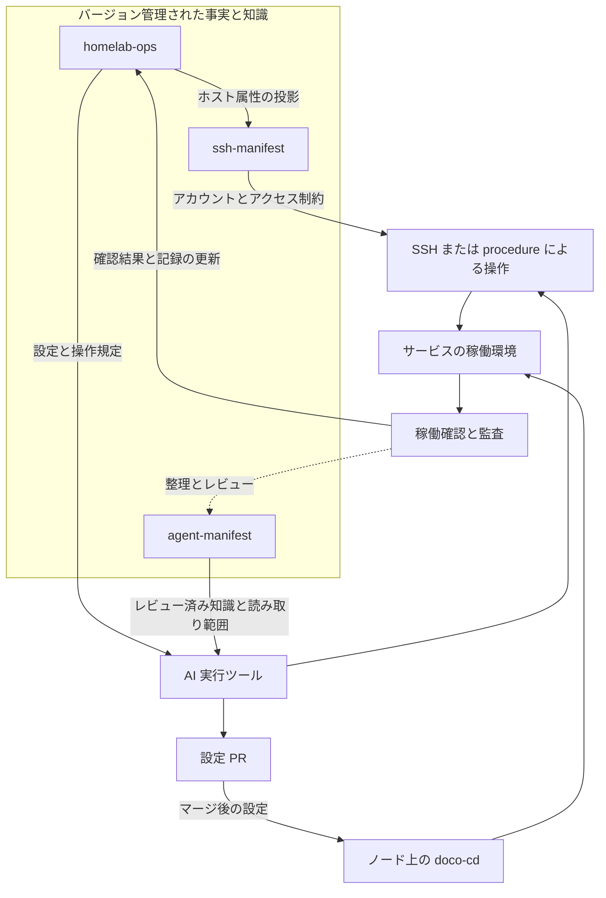

本記事は[なぜ Homelab を運用するのか](/ja/posts/why-homelab/)と[Homelab の管理](/ja/posts/managing-homelab-with-ai/)に続き、この管理体系のアーキテクチャとインターフェースを紹介します。

homelab-ops は、Git、AI 実行ツール、ノードでの実行機構を中心に構成した運用体系です。環境の宣言、アクセス権限、操作の実装、長期知識に明確な構造を与えることで、異なるツールが共通のコンテキストで作業し、後から追跡できる結果を残せるようにしています。

この体系を理解するには、採用している運用技術スタックから見ると分かりやすくなります。選定は具体的な仕事を軸にしています。設定をどう保存して配信するか、稼働状態をどう観測するか、個々のタスクの履歴をどう調べるか、異常を対応が必要な人にどう届けるか、という仕事です。

| 仕事                       | 採用技術                             | 選定理由と役割                                                                                         |
| -------------------------- | ------------------------------------ | ------------------------------------------------------------------------------------------------------ |
| 設定と協働                 | Git、GitHub PR / Issues、CI          | バージョンと差分で変更を整理し、タスクを関連付け、自動で判定できる制約を確認する                       |
| 設定の配信                 | GitOps、Docker Compose、doco-cd      | 既存の Compose サービス定義を活用し、承認された設定をノードが取得してデプロイする                      |
| メトリクス収集             | Grafana Alloy、単独の exporter       | 標準的なメトリクスをできるだけ再利用し、ノードのリソースと収集能力に応じて混在構成を維持する           |
| メトリクス保存とルール評価 | Prometheus                           | 時系列データを保存し、クエリを提供し、アラートルールを評価する                                         |
| 傾向と関連の表示           | Grafana                              | 既存のダッシュボードを活用し、クエリ、フィールド結合、変換でノードやコンポーネントの状態を確認する     |
| タスク履歴と構造化クエリ   | SQLite、Datasette                    | 既存のイベント DB や読み取りモデルに閲覧、絞り込み、SQL、API を提供し、既成の検索画面を再利用する      |
| アラート処理               | Alertmanager                         | ルールが生成したアラートをグループ化、重複排除、サイレンス、抑制し、受信先へ振り分ける                 |
| メッセージ配信             | ntfy などの通知経路                  | 単純な HTTP の発行・購読で、スクリプトやアラートのメッセージをスマートフォンやデスクトップなどへ届ける |
| ログと生存確認             | Dozzle、Uptime Kuma、Healthchecks.io | それぞれコンテナログの閲覧、サービスへの到達性確認、定期タスクが期限内に報告したかの確認を担う         |

**GitOps が設定配信を整理し、doco-cd が Compose 環境での実行を担います。** GitOps では期待する状態を宣言として記述し、バージョン履歴を保存します。稼働側がその宣言を取得し、継続的に適用を試みます。ここでは「どの設定を承認したか」と「ノードがどの設定を実行するか」を結び付けるために使っています。バージョン管理の対象はデプロイの宣言であり、永続データは引き続き別のストレージとバックアップ機構で管理します。[GitOps の原則](https://opengitops.dev/)

既存サービスの多くが Docker Compose を使っているため、デプロイ層にはこの形式に対応する doco-cd を選びました。Git からデプロイの入力を取得し、ポーリングや webhook を契機に設定を配信できます。Compose とデプロイ登録は引き続きリポジトリで管理し、ノード上のプロセスが適用を担います。既存のサービス定義をそのまま配信フローに組み込める一方、Git へのアクセス、イメージへのアクセス、ホスト上の Docker 権限、設定の復号も、デプロイ経路で管理すべき依存関係になります。[doco-cd ドキュメント](https://doco.cd/latest/)

**観測データは、答える問いに応じて分けて保存します。** Prometheus はメトリクスと時系列を担い、リソース使用量、レート、時間に伴う状態変化の確認に適しています。異なるコレクターやスクリプトの出力を共通のメトリクスとクエリルールに取り込み、クエリやアラートの設定も Git に収められます。収集側では、負荷を許容できるノードで Alloy を使い、一部のホストメトリクスと textfile 入力をまとめます。リソースが限られるノードや未移行のノードでは、引き続き単独の exporter を使います。既存のメトリクス名とダッシュボードを維持できますが、ノードごとの収集方法の違いも保守する必要があります。

Grafana は傾向と関連の表示を担います。採用を続ける理由には、既存のダッシュボードに加えて、フィールド結合、名前変更、クエリ結果の変換といった機能があります。異なる OS やコレクターのデータを、表示層で読みやすいビューに整理できます。ここでメトリクスのアラートルールを評価するのは引き続き Prometheus であり、ダッシュボードは人がデータをさらに理解するために使います。[Grafana のデータ変換](https://grafana.com/docs/grafana/latest/visualizations/panels-visualizations/query-transform-data/transform-data/)

Datasette が扱うのは別の問いです。あるタスクは実行されたか、どのバッチの処理が失敗したか、その実行で何件の結果が出たか、といった問いです。これらの記録を SQLite に保存し、実行、バッチ、ソース、状態で検索できます。この体系にはジョブのイベント DB と、表示用の構造化された読み取りモデルの両方があります。Datasette はそのデータに閲覧、絞り込み、SQL、JSON API を提供します。既存の SQLite データを再利用すれば、検索の入口を用意でき、タスクの種類ごとに管理用バックエンドを作る手間を減らせます。ジョブイベントには最終状態とログへの参照を残し、実行の詳細は引き続きログに記録します。[Datasette のクエリ](https://docs.datasette.io/en/stable/sql_queries.html) · [JSON API](https://docs.datasette.io/en/stable/json_api.html)

**Alertmanager と ntfy は、アラート経路の異なる位置にあります。** Prometheus のルールがアラートを生成すると、Alertmanager がグループ化、繰り返し通知、サイレンス、関連するアラート間の抑制、受信先への振り分けを処理します。ntfy はセルフホスト可能な HTTP メッセージの発行・購読を提供します。スクリプトからの通知を受け取れるほか、アダプターを介してアラートメッセージも受け取れます。HTTP インターフェースはスクリプトとの接続を容易にし、トピックの購読は発行側と受信端末を切り離します。前者は一群のアラートをどう送るかを処理し、後者はメッセージを端末まで届ける経路を担います。これによりルール評価、通知方針、端末への配信をそれぞれ保守できます。対応済みか、復旧したかは、その後の操作と確認によって判断します。[Alertmanager](https://prometheus.io/docs/alerting/latest/alertmanager/) · [ntfy](https://docs.ntfy.sh/)

このほか、コンテナログ、サービスへの到達性、タスクのハートビートにも、それぞれ検索や確認の入口があります。そのため、ここでいう「監視」には、メトリクス、タスク履歴、ログ、アラート、生存確認という複数の情報が含まれます。相互に関連付けられる一方、それぞれのデータの粒度も保ちます。サービスポートに到達できること、あるジョブが成功したこと、一定期間のリソース状態が正常だったことは、それぞれ異なる問いへの答えです。

これらのコンポーネントは、設定の配信方法も異なります。登録済みの Compose サービスは doco-cd に任せられます。一部のホスト用コレクターは OS 標準のサービス管理を使い、監視センターの一部のルールと設定は、今もオペレーターが実行するリリース手順で反映します。技術スタックは共通のインターフェースを提供しますが、個々のコンポーネントのデプロイ状態とリリース方法は別々に記録する必要があります。

アーキテクチャとして見ると、このシステムには相互につながる2つの部分があります。稼働面は家の自動化、ストレージ、メディア、その他の個人向けサービスを支え、ホスト、コンテナ、ネットワーク、データを含みます。管理面は、これらのサービスの設定、アクセス関係、操作手順、確認結果を管理します。本記事でいう homelab-ops の体系は、主に後者と、それが稼働面につながる仕組みを指します。

管理面の責務は3つのリポジトリに分かれています。

| リポジトリ       | 正式な情報源として担う範囲                                                           | 他の部分へ提供するもの                                                 |
| ---------------- | ------------------------------------------------------------------------------------ | ---------------------------------------------------------------------- |
| `homelab-ops`    | インフラとサービスの宣言、デプロイ設定、操作の実装、アーキテクチャ上の決定、作業追跡 | 環境の台帳、デプロイの入力、操作の入口、検証の根拠                     |
| `ssh-manifest`   | SSH ホストとアカウント、鍵の識別情報、認可関係、アクセス制限                         | アクセス設定、権限確認、ローテーションと復旧のツール                   |
| `agent-manifest` | AI インスタンスの登録、知識空間とアクセス範囲、レビュー済みの長期知識                | セッションをまたぐコンテキスト、インデックス、各ツール向けの知識の投影 |

この3つの区分は、インフラモデル、アクセスモデル、知識モデルという3種類のデータモデルに対応します。それぞれに独自の保守方法があり、他の部分に渡す情報があります。

ここでいう「投影」とは、正式な情報源から用途に応じてデータを選び、利用側が必要とする構造に変換した派生コピーです。ソースとの対応関係を保ち、再生成できます。元の事実を変更する場合は、引き続き上流で修正します。

例えば、ホストの OS とネットワーク属性は `homelab-ops` の台帳で管理します。`ssh-manifest` は、必要なホスト名、アドレス、OS などのフィールドを取り込み、独自の**ホスト投影**を生成してコミットしたうえで、SSH アカウント、鍵、認可関係を補います。この投影により、SSH ツールはホスト情報をローカルで利用できます。各属性の元の定義は、引き続き上流の台帳が担います。アクセス確認や復旧では、このリポジトリに保存済みのバージョンを直接使えます。

リポジトリ間のこの関係では、明示的な生成とバージョン管理を使います。投影が上流と一致しているかを確認するコストが生じる一方、入力バージョンの固定、差分のレビュー、他のコンポーネントに到達できない場合の既存設定の利用が可能になります。

AI は、これらの情報源と実行機構の間に位置します。Claude Code、Codex、Hermes はそれぞれ独自のセッション、ツール呼び出し、コンテキストの仕組みを持ちます。アクセスを許可されたリポジトリを直接読むことも、**範囲を制限した投影**を読むこともできます。後者は、特定の AI に許可された範囲に応じてソースから抽出・生成した利用側のコピーです。例えば、知識スナップショットには、その AI が読める知識空間のレビュー済み項目だけを含め、レビュー待ちの内容や別の知識空間を除外できます。内容の選別は生成時に行い、読み書きの制限は読み取り専用マウントや制限付き検索インターフェースなどの具体的な機構で実施します。

AI はこれらの資料からタスクの計画を立て、利用可能な実行経路を通じて稼働環境にアクセスします。推奨モデルは `agent-manifest` に登録できますが、実際のモデル呼び出しは各実行ツールとその設定が決めます。

次の図は主要なインターフェースを示します。実線は資料の利用または実行経路、破線は整理とレビューを経て知識が還流する経路です。

図には、役割の異なる2種類の実行経路があります。

**設定のリリース経路は、Git 内の設定を入力とします。** GitOps の対象となるサービスでは、PR のマージ後、ノード上の doco-cd がそのノードのデプロイ登録に従って設定を取得・適用します。各ノードにはそれぞれのデプロイの入口があります。同じリポジトリ内の設定でも、対象ノードで登録されて初めてデプロイに使われます。

この経路は、設定の作成とノードでの実行を分けます。AI は Compose、デプロイ登録、操作ドキュメントを準備でき、実際の適用はノード上のデプロイプロセスが担います。ノードが設定を取得できたか、必要な認証情報を復号できたか、コンテナが正常に起動したかは、後から確認すべき稼働結果です。

**直接操作の経路は、確認と認可済みの管理操作に使います。** SSH と、procedure 基盤に組み込まれた操作が含まれます。両者を組み合わせることもできます。procedure に明確な確認手順をまとめても、実際の権限は実行アカウントと対象システムの制限を受けます。

procedure 基盤は、再利用可能な操作を3つに分けます。manifest が引数、適用環境、認可条件を宣言し、独立したスクリプトが操作を実装し、実行ツールのアダプター層が呼び出しを担当します。MCP は `list_procedures` と `run_procedure` の2つの入口を公開し、必要に応じて操作を見つけてから、指定した操作を実行します。操作が増えても、各 AI ツールは同じ実装を再利用できます。

確認もこの呼び出し経路に沿って行います。操作が現在の環境に適用できるか、引数が宣言に合うか、実行ファイルが許可された場所にあるか、認可条件が満たされているかを確認します。SSH、端末、その他のネイティブツールも存在するため、procedure の確認範囲はこの基盤に入る呼び出しです。他の経路では、それぞれのシステム権限とツールの制限に依存します。

アクセスモデルは、これらの操作をどの身元で行うかをさらに決めます。

`ssh-manifest` は、ホスト、アイデンティティ、認可エッジを別々にモデル化します。アイデンティティにはユーザーとホストが含まれます。認可エッジは、ある送信元のアイデンティティがどの接続先のアイデンティティにアクセスできるかを、接続元制限と SSH オプションとともに表します。対象が具体的なアカウントなので、「同じホストでも監査アカウントと管理アカウントでは可能な操作が異なる」と表現でき、ある鍵が本来存在してはいけないアカウントに入っていないかも確認できます。

モデルはコード生成を経て、クライアント設定、鍵設定の生成、アクセス検証などのツールに利用されます。ログイン後の能力は、引き続き OS のアカウント権限、sudo ルール、機能を固定した wrapper が制限します。現在のモデルと一部の旧ツールの間には互換インターフェースが残り、新しい認可関係もすべて自動で反映されるわけではありません。宣言が対象マシンの実際の設定になるまでには、別途確認が必要です。

ノード上では、**サービスのデプロイと管理資料の配布は、別々の整合処理です**。前者はアプリケーション設定を稼働状態に反映し、後者はリポジトリ、スクリプト、関連する管理資料を実行場所へ届けます。最新の資料を取得したからといってサービスが更新されたとは限らず、サービスが正常に動いていても、ノード上の管理スクリプトが最新版だとは証明できません。

資料の配布は、現在も旧 fleet-sync から新方式への移行途中です。新方式は、ノードによる Git のプル、通知による起動、定期実行によるフォールバックを使います。関連コードは用意されていますが、全面的な切り替えは未完了です。この状態は、サービスのデプロイ状態とは別に観測する必要があります。

長期知識にも、独自の情報源と利用側があります。

`agent-manifest` はレビュー済みの知識項目を保存し、空間ごとに読み書きの範囲を管理します。各 AI ツールは、ローカルの記憶ファイル、階層型インデックス、読み取り専用スナップショットと検索ツールなど、適した形式を使えます。投影と同期の過程では対応するソースのバージョンを記録し、レビュー済みの内容を Git から再生成できます。

知識の還流は、checkpoint、差分確認、PR レビューを通じて行います。下流側の照合では、リポジトリ、利用側、前回同期時の基準を比較し、競合が見つかれば該当するツールや人に処理を委ねます。現在もこれらの手順を進めるには人の関与が必要で、自動インデックスや照合スクリプトは、それぞれ定められた部分だけを担います。

知識とインフラの事実は、用途も異なります。記憶は過去の操作で遭遇した問題を説明し、Runbook は手順を示し、台帳はサービスの場所を宣言できます。それらが今の環境にも当てはまるかは、コード、設定、稼働確認を合わせて確かめる必要があります。

作業の協調が、これらの個別の過程をつなぎます。Issue と epic はタスクと依存関係を保存し、独立した worktree はセッションごとの変更を分離し、PR はレビュー対象の変更をひとまとまりに固定し、CI は機械的に判定できる制約を確認します。これらは作業状態を記録しますが、サービスへの変更が実際に反映されたかは、ノード上の証拠が必要です。

そのため、管理面には意味の異なる複数の記録が保存されます。

| 記録                              | 表す状態                                   |
| --------------------------------- | ------------------------------------------ |
| 台帳、設定、アクセスモデル        | システムが何を宣言しているか               |
| Commit、PR、デプロイのバージョン  | どの入力が変更、承認、配信されたか         |
| メトリクス、ログ、API、権限の確認 | 特定の時刻と場所で何が観測されたか         |
| Audit と journal                  | 確認の根拠、出力、出来事の経過             |
| レビュー済みの長期知識            | 後続タスクで再利用する価値がある結論は何か |

これらの記録は、コミットのバージョン、ソースパス、対象、確認時刻によってつながります。変更に問題が生じた場合、入力、配信、稼働結果をそれぞれ追跡でき、あるセッションの最終回答から全過程を組み立て直す必要がありません。

このアーキテクチャの接点は、事実、権限、実行、フィードバックの間のインターフェースです。リポジトリが追跡可能な入力を提供し、AI 実行ツールが操作を組み立てて呼び出し、ノードの機構が設定を適用し、確認結果が作業記録に戻り、残す価値のある経験が知識庫に入ります。現在は各部分で自動化の程度が異なります。インターフェース、情報源、状態がどれだけ明確かによって、全体として協調できるかが決まります。
