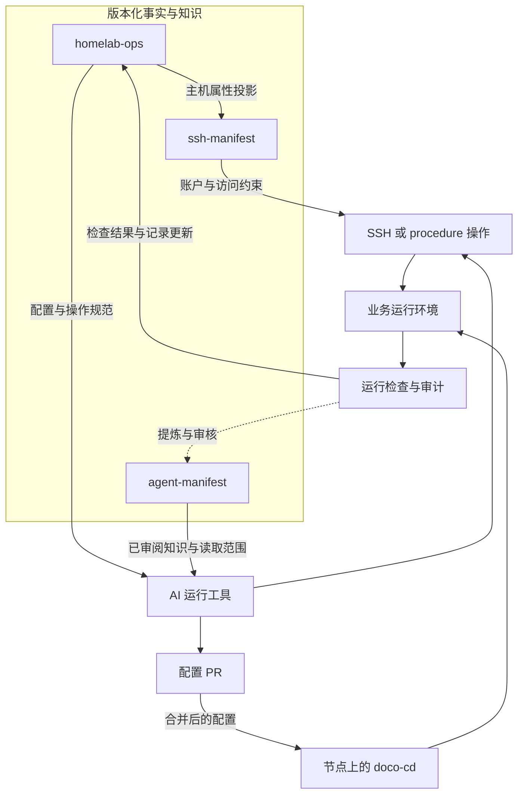

本篇接续[为什么要 Homelab](/posts/why-homelab/)与[如何管理 Homelab](/posts/managing-homelab-with-ai/)，介绍这套管理体系的架构与接口。

homelab-ops 是一套围绕 Git、AI 运行工具和节点执行机制组织起来的运维体系。它把环境声明、访问权限、操作实现和长期知识放进明确的结构中，让不同工具能够在同一套上下文下工作，并留下可以追查的结果。

理解这套体系，可以先看它采用的运维技术栈。选型围绕几类具体工作展开：怎样保存和交付配置，怎样观察运行状态，怎样查询单次任务的历史，以及怎样把异常送到需要处理的人面前。

| 工作                 | 采用的技术                           | 选型依据与职责                                                   |
| -------------------- | ------------------------------------ | ---------------------------------------------------------------- |
| 配置与协作           | Git、GitHub PR / Issues、CI          | 用版本和差异组织变更，关联任务，并运行可自动检查的约束           |
| 配置交付             | GitOps、Docker Compose、doco-cd      | 沿用现有 Compose 服务定义，让节点取得已接受的配置并执行部署      |
| 指标采集             | Grafana Alloy、独立 exporter         | 尽量复用标准指标；按节点资源与采集能力保留混合部署               |
| 指标存储与规则       | Prometheus                           | 保存时序数据，提供查询，并计算告警规则                           |
| 趋势与关联展示       | Grafana                              | 沿用已有面板，通过查询、字段连接和变换查看不同节点及组件的状态   |
| 任务历史与结构化查询 | SQLite、Datasette                    | 从已有事件库或读模型提供浏览、筛选、SQL 和 API，复用现成查询界面 |
| 告警处理             | Alertmanager                         | 对规则产生的告警分组、去重、静默、抑制，并路由到接收端           |
| 消息投递             | ntfy 等通知通道                      | 通过简单的 HTTP 发布与订阅，把脚本或告警消息送到手机、桌面等终端 |
| 日志与存活检查       | Dozzle、Uptime Kuma、Healthchecks.io | 分别查看容器日志、探测服务可达性，以及检查定时任务是否按期报到   |

**GitOps 组织配置的交付，doco-cd 承担 Compose 环境中的执行。** GitOps 将预期状态写成声明，保留版本历史，并由运行侧取得这些声明、持续尝试应用。这里用它把“接受哪组配置”和“节点执行哪组配置”联系起来。版本化的是部署声明，持久化数据仍由独立的存储和备份机制管理。[GitOps 原则](https://opengitops.dev/)

现有服务大量使用 Docker Compose，因此部署层选用了适配这一形式的 doco-cd。它支持从 Git 拉取部署输入，通过轮询或 webhook 触发配置交付。仓库内继续维护 Compose 与部署登记，节点上的进程负责应用。这个选择让已经采用的服务定义能够直接进入交付流程；与此同时，Git 访问、镜像访问、宿主 Docker 权限和配置解密，也成为部署链路需要管理的依赖。[doco-cd 文档](https://doco.cd/latest/)

**观测数据则按它回答的问题分开存放。** Prometheus 负责指标和时间序列，适合查询资源用量、速率和状态随时间的变化。它让不同采集器和脚本输出进入同一套指标与查询规则中，查询和告警配置也可以纳入 Git。采集侧在能够承担开销的节点上使用 Alloy，统一部分主机指标和 textfile 输入；资源受限或尚未迁移的节点继续使用独立 exporter。这样能够保留既有指标名称和面板，但也需要维护不同节点的采集差异。

Grafana 承担趋势和关联展示。保留它的依据包括已有仪表盘，以及字段连接、重命名和查询结果变换等能力：不同操作系统和采集器的数据，可以在展示层组织成可读的视图。这里的指标告警规则仍由 Prometheus 计算，面板负责帮助人进一步理解数据。[Grafana 数据变换](https://grafana.com/docs/grafana/latest/visualizations/panels-visualizations/query-transform-data/transform-data/)

Datasette 面向另一类问题：某个任务有没有运行、哪一批数据处理失败、当次输出了多少结果。这些记录可以保存在 SQLite 中，按运行、批次、来源和状态查询。体系中既有作业事件库，也有供展示使用的结构化读模型；Datasette 在这些数据之上提供浏览、筛选、SQL 和 JSON API。复用已有 SQLite 数据，就能建立查询入口，减少为每类任务另写一套后台的工作。作业事件保留终态与日志指针，详细执行过程继续由日志承载。[Datasette 查询](https://docs.datasette.io/en/stable/sql_queries.html) · [JSON API](https://docs.datasette.io/en/stable/json_api.html)

**Alertmanager 与 ntfy 处在告警链路的不同位置。** Prometheus 规则产生告警后，Alertmanager 处理分组、重复通知、静默、相关告警之间的抑制和接收端路由。ntfy 提供可自托管的 HTTP 消息发布与订阅，可接收脚本通知，也可通过适配接收告警消息。HTTP 接口便于脚本接入，主题订阅则将发布者与接收终端解耦。前者处理一组告警怎样送出，后者承担消息到达终端的通道，使规则计算、通知策略和终端投递能够分别维护。是否已经处理或恢复，仍由后续操作与检查确认。[Alertmanager](https://prometheus.io/docs/alerting/latest/alertmanager/) · [ntfy](https://docs.ntfy.sh/)

此外，容器日志、服务可达性和任务心跳各有查询或探测入口。因此，“监控”在这里包含指标、任务历史、日志、告警和存活检查几种信息，它们可以互相关联，也保留各自的数据粒度。一个服务端口可达、某次作业成功和一段时间内资源正常，分别回答不同的问题。

这些组件也各有配置交付方式。已登记的 Compose 服务可以交给 doco-cd；部分主机采集器依靠原生服务管理；监控中心的部分规则与配置仍通过操作员执行的发布步骤生效。技术栈提供共同的接口，具体组件的部署状态和发布方式仍需要分别记录。

从架构上看，这套系统有两个相互连接的部分。运行面承载家居自动化、存储、媒体和其他个人服务，包括主机、容器、网络和数据。管理面维护这些服务的配置、访问关系、操作流程及检查结果。本文所说的 homelab-ops 体系，主要指后者，以及它与运行面的连接方式。

管理面的职责分布在三个仓库中。

| 仓库             | 权威范围                                                   | 向其他部分提供什么                               |
| ---------------- | ---------------------------------------------------------- | ------------------------------------------------ |
| `homelab-ops`    | 基础设施和服务声明、部署配置、操作实现、架构决策、工作追踪 | 环境清单、部署输入、操作入口与验证依据           |
| `ssh-manifest`   | SSH 主机与账户、密钥身份、授权关系及访问限制               | 访问配置、权限检查、轮换和恢复工具               |
| `agent-manifest` | AI 实例登记、知识空间与访问范围、审核后的长期知识          | 跨会话上下文、索引，以及供不同工具使用的知识投影 |

三个仓库的划分对应三种数据模型：基础设施模型、访问模型和知识模型。每种模型有自己的维护方式，也有需要交给其他部分使用的信息。

这里的“投影”，是从权威来源中按用途选取数据，再转换成使用方需要的结构所得到的派生副本。它保留与来源的对应关系，可以重新生成；需要修改原始事实时，仍然回到上游维护。

例如，主机的操作系统和网络属性由 `homelab-ops` 的库存维护。`ssh-manifest` 导入其中需要的主机名称、地址、操作系统等字段，生成并提交自己的**主机投影**，再补充 SSH 账户、密钥和授权关系。这个投影为 SSH 工具提供本地可用的主机资料，上游库存仍负责这些主机属性的原始定义。执行访问检查或恢复时，可以直接使用本仓库已经保存的版本。

这种跨仓关系采用显式生成和版本管理。它带来的成本是需要检查投影是否与上游一致；得到的能力则是可以固定输入版本、审阅差异，并在其他组件不可达时继续使用已有配置。

AI 位于这些来源与执行机制之间。Claude Code、Codex 和 Hermes 各自拥有会话、工具调用和上下文机制。它们可以直接读取获准访问的仓库，也可以读取**受限投影**：按照某个 AI 的获准范围，从源资料中筛选并生成的使用侧副本。例如，一份知识快照可以只包含已经审核、属于该 AI 允许读取的知识空间的条目，排除待审内容和其他知识空间。内容筛选在生成时完成，读写限制则由只读挂载或受限检索接口等具体机制落实。

AI 使用这些资料形成任务方案，再通过可用的执行路径接触运行环境。模型使用建议可以登记在 `agent-manifest`，具体模型调用仍由对应运行工具及其配置决定。

下面这张图表示主要接口。实线表示资料使用或执行路径，虚线表示需要经过提炼与审核的知识回流。

图中包含两类作用不同的执行路径。

**配置发布路径以 Git 中的配置为输入。** 对已纳入 GitOps 的服务，PR 合并后，节点上的 doco-cd 根据本节点的部署登记拉取并应用配置。不同节点各有自己的部署入口；同一仓库中的一份配置，必须被相应节点登记后才会参与部署。

这条路径将配置编写与节点执行分开。AI 可以准备 Compose、部署登记和操作文档，实际应用配置由节点上的部署进程完成。节点是否成功取得配置、是否能够解密所需的凭据、容器是否正常启动，都属于后续需要检查的运行结果。

**直接操作路径用于检查和已授权的管理动作。** 它包括 SSH，以及已经接入 procedure 基座的操作。两者可以交叉使用：一个 procedure 可以封装明确的检查步骤，具体权限仍受到执行账户和目标系统的限制。

procedure 基座把可复用操作拆成三部分：manifest 声明参数、适用环境和授权条件；独立脚本实现操作；运行工具的适配层负责调用。MCP 对外提供 `list_procedures` 和 `run_procedure` 两个入口，先按需发现，再执行指定操作。这样，操作数量增加时，各个 AI 工具可以继续复用同一份实现。

检查也沿这条调用路径展开：操作是否适用于当前环境，参数是否符合声明，执行文件是否位于允许的位置，以及授权条件是否满足。SSH、终端和其他原生工具仍然存在，因此 procedure 的检查范围对应进入该基座的调用；其他路径依靠各自的系统权限和工具限制。

访问模型进一步决定这些操作以什么身份发生。

`ssh-manifest` 将主机、身份和授权边分别建模。身份包含用户与主机，授权边描述一个源身份可以访问哪个目标身份，并附带来源限制和 SSH 选项。目标是一个具体账户，因此可以表达“同一台主机上的审计账户和管理账户拥有不同能力”，也可以检查某个密钥是否出现在不应出现的账户中。

模型经过代码生成，供客户端配置、密钥配置渲染、访问验证等工具使用。操作系统中的账户权限、sudo 规则和固定功能 wrapper，继续限制登录后的能力。当前模型与部分旧工具之间仍有兼容接口，新授权关系也并非全部自动部署；从声明到目标机器的实际配置，需要单独确认。

在节点上，**服务部署与管理资料分发是两种不同的协调过程**。前者让应用配置进入运行状态；后者把仓库、脚本及相关管理资料送到执行位置。取得最新资料并不意味着服务已经更新，服务正常运行也不能证明节点上的管理脚本是最新版本。

资料分发当前仍存在旧 fleet-sync 与新方案的迁移过程。新方案采用节点拉取 Git、通知触发和定时回退，相关代码已经建立，全面切换仍有待完成。这部分状态需要与服务部署状态分别观察。

长期知识也有自己的来源和使用侧。

`agent-manifest` 保存审核后的知识条目，并按空间管理读取和写入范围。不同 AI 工具可以使用各自适合的形式：本地记忆文件、分层索引，或者只读快照与检索工具。投影和同步过程记录对应的来源版本，已审核内容能够从 Git 重新生成。

知识回流则通过 checkpoint、差异检查和 PR 审阅完成。下行对账比较仓库、使用侧和上次同步基线，发现冲突后交由相应工具或人处理。当前这些步骤仍需要人工推动，自动索引和对账脚本只承担各自确定的部分。

知识与基础设施事实也有不同用途。记忆可以说明某种操作曾经遇到的问题，Runbook 可以给出步骤，库存可以声明服务所在位置；是否仍符合当前环境，要由代码、配置和运行检查共同确认。

工作协调把这些局部过程连接起来。Issue 和 epic 保存任务及依赖，独立 worktree 隔离不同会话的修改，PR 固定一组待审阅变更，CI 检查能够机械判断的约束。它们记录工作状态，但服务是否已经生效，还需要节点上的证据。

因此，管理面同时保存几种含义不同的记录。

| 记录                       | 表达的状态                   |
| -------------------------- | ---------------------------- |
| 库存、配置和访问模型       | 系统声明了什么               |
| Commit、PR 和部署版本      | 哪组输入被修改、接受或交付   |
| 指标、日志、API 与权限探测 | 在具体时间和位置观察到了什么 |
| Audit 与 journal           | 检查依据、输出及事件过程     |
| 经审核的长期知识           | 哪些结论值得供后续任务复用   |

这些记录通过提交版本、来源路径、目标和检查时间联系起来。一项变更出现偏差时，可以分别追查输入、交付和运行结果，而不必从某个会话的最终回复重新拼接全过程。

这套架构的连接点，就是事实、权限、执行和反馈之间的接口：仓库提供可追溯输入，AI 运行工具形成和调用操作，节点机制应用配置，检查结果回填工作记录，值得保留的经验再进入知识库。当前各部分的自动化程度不同，接口、来源和状态的明确程度，决定了它们能否协同工作。
